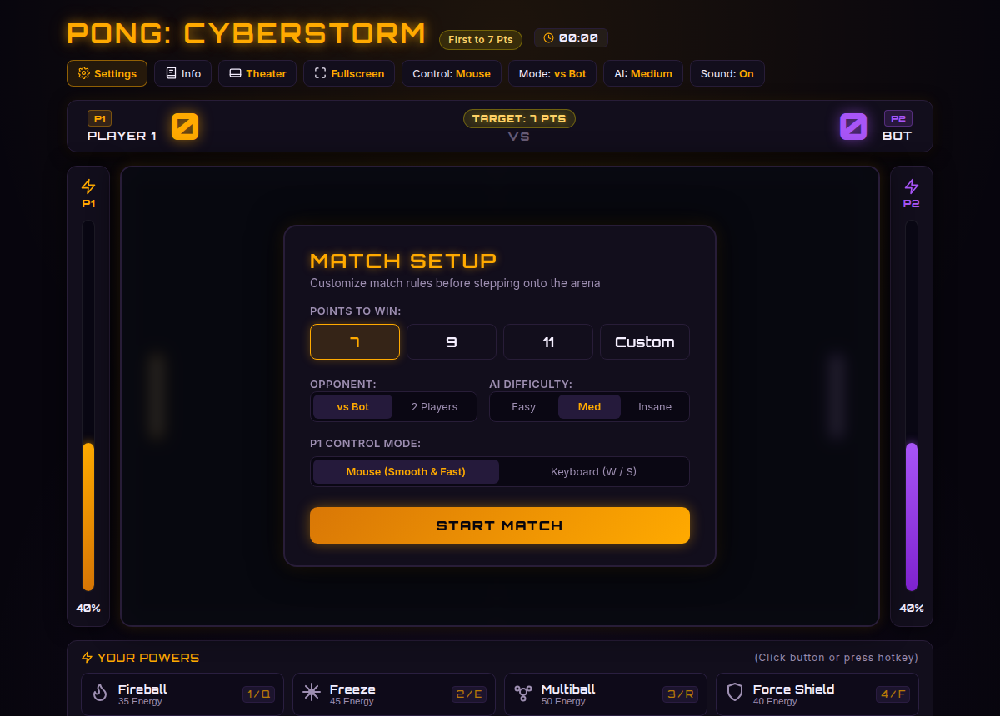
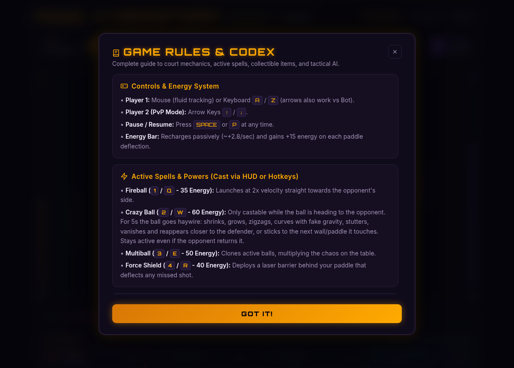
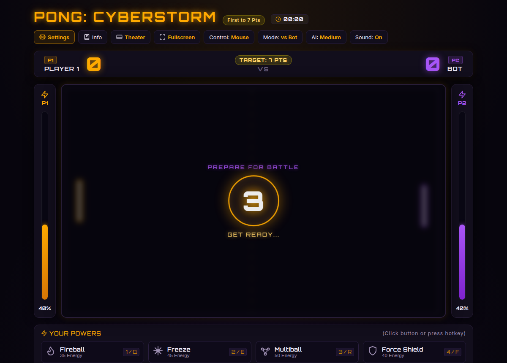
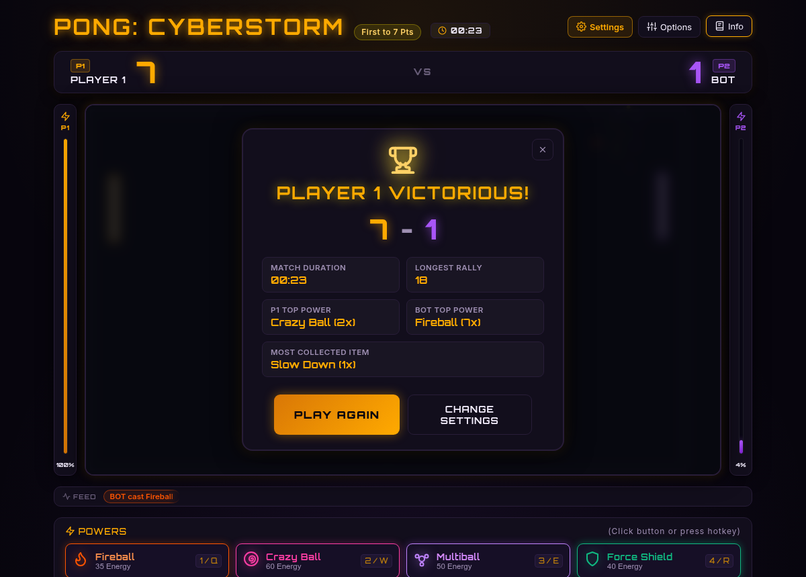

# Pong: Cyberstorm

A high-octane, neon-drenched cyberpunk reimagining of the classic arcade game. Powered by pure modern web standards, *Pong: Cyberstorm* infuses traditional paddle mechanics with tactical energy spells, collectible court modifiers, predictive trajectory AI, procedural Web Audio sound synthesis, and detailed post-match analytics.

> **Deployed here:** [https://fmarcio.github.io/pong-cyberstorm/](https://fmarcio.github.io/pong-cyberstorm/)


---

## Game Dynamics & Overview

In *Pong: Cyberstorm*, matches are played to a customizable target score (default **7 points**, with presets for **9**, **11**, or custom target up to **99**). Every point is a tense tactical duel fought across a digital court where deflection angles, energy economy, and timely ability execution determine the victor.

### Energy System
Both competitors possess an independent **Energy Capacitor** (ranging from `0%` to `100%`) displayed on side energy columns flanking the court:
- **Passive Generation:** Regenerates constantly at `+8%` energy per second.
- **Deflection Bonus:** Successfully striking the ball with your paddle yields an instant `+15%` energy surge.
- **Strategic Deployment:** Energy fuels your tactical spells; managing capacitor levels is essential to counter enemy attacks and mount breakneck offensives.

---

## Tactical Spells (HUD & Hotkeys)

Players can cast four distinct cyber-abilities during active play. Spells can be activated by clicking their respective HUD buttons or via keyboard shortcuts:

| Spell | Icon | Cost | Hotkeys | Description & Strategic Effect |
| :--- | :---: | :---: | :---: | :--- |
| **Fireball** |  | `35 Energy` | <kbd>1</kbd> / <kbd>Q</kbd> | Accelerates the ball to **2x velocity** in a blaze of red particles directly toward the opponent's goal line. |
| **Freeze** |  | `45 Energy` | <kbd>2</kbd> / <kbd>E</kbd> | Glaciates the opponent's paddle with a frost aura, reducing their movement speed by **50% for 4 seconds**. |
| **Multiball** |  | `50 Energy` | <kbd>3</kbd> / <kbd>R</kbd> | Clones active balls on the arena, multiplying trajectories and overwhelming opponent defenses. |
| **Force Shield** |  | `40 Energy` | <kbd>4</kbd> / <kbd>F</kbd> | Deploys a laser barrier behind your paddle that deflects any missed shot, granting a second chance. |

---

## In-Court Collectible Items

Throughout the match, cybernetic item cubes periodically materialize on the court. Driving the ball through an item claims its effect. All items feature **cumulative stacking** and **independent 5-second countdown timers**:

-  **Reduce (Crimson):** Slashes opponent paddle height by `30%` for 5s.
-  **Size It Up (Emerald):** Expands your paddle height by `+30%` for 5s.
-  **Slow Down (Cyan):** Decreases ball velocity by `30%` for 5s, restoring control to frantic rallies.
-  **Energy Boost (Gold):** Instantly injects `+30%` energy into your capacitor.
-  **Energy Down (Purple):** Drains `30%` energy directly from your opponent's capacitor.
-  **Bomb Hazard (Red-Orange):** Rare anomaly! Ball inflates with warning flashes for 5s before detonating into mini shrapnel balls. Every unreturned shrapnel awards `+1` point to the opponent.
-  **Invisibility (Indigo):** Shrouds the ball in stealth cloaking, flickering between normal vision and 20% ghost opacity while travelling toward the enemy.

---

## Controls & View Modes

### Control Schemes

| Action | Player 1 (Left) | Player 2 (Right, PvP) |
| :--- | :--- | :--- |
| **Paddle Movement** | **Mouse** (smooth 1:1 tracking) or <kbd>W</kbd> / <kbd>S</kbd> | Arrow Keys <kbd>↑</kbd> / <kbd>↓</kbd> |
| **Cast Fireball** | <kbd>1</kbd> or <kbd>Q</kbd> | — |
| **Cast Freeze** | <kbd>2</kbd> or <kbd>E</kbd> | — |
| **Cast Multiball** | <kbd>3</kbd> or <kbd>R</kbd> | — |
| **Cast Force Shield** | <kbd>4</kbd> or <kbd>F</kbd> | — |

### System & Navigation Hotkeys
- <kbd>Space</kbd> or <kbd>P</kbd>: Pause / Resume active match.
- <kbd>R</kbd>: Restart match directly.
- <kbd>Esc</kbd>: Dismiss open modal dialogues (Match Setup, Rules Codex, Match Over).
- **Theater Mode:** Broadens arena framing for an immersive, widescreen experience.
- **Fullscreen Mode:** Expands court presentation to native full display resolution.

---

## Opponent Modes & Tactical AI

- **vs Bot Mode:** Challenge an intelligent AI agent engineered with predictive physics calculations:
  - **Easy:** Relaxed tracking with reaction delays and minor aiming variances.
  - **Medium:** Balanced calculation, solid paddle positioning, and measured spell reactions.
  - **Insane:** Instant predictive pathfinding, angular slice deflections, and aggressive spell usage.
- **2-Player Local PvP Mode:** Head-to-head competition on the same keyboard or mouse + keyboard combo.

---

## Match Showcase

| Match Setup Modal | In-Game Rules & Codex |
| :---: | :---: |
|  |  |

| Pre-Match Countdown | Post-Match Analytics & Victory |
| :---: | :---: |
|  |  |

---

## Tech Stack & Architecture

Built from the ground up prioritizing zero dependencies, fast 60+ FPS execution, and high security standards:

- **Frontend & Rendering:** Pure HTML5 Canvas and CSS3 with custom design tokens, Orbitron & Inter typography, and retro scanline effects.
- **Modular Architecture:** Separation of concerns across dedicated modules:
  - `SoundController.js`: Complete procedural audio synthesizer using the native Web Audio API (oscillators, biquad filters, distortion curves, and exponential gain ramps). Zero external audio files required.
  - `Ball.js`: Physics-based deflection geometry, velocity clamping, trail particle emission, and status effects.
  - `CourtItem.js`: Procedural item spawning, canvas rendering, collision detection, and stackable effect timers.
  - `TacticalAI.js`: Multi-difficulty predictive ball interceptor and spell-casting intelligence.
  - `UIManager.js`: DOM manipulation, HUD rendering, modal controls, and score updates.
  - `PongGame.js`: Master game loop, state machine, collision resolution, and lifecycle coordination.
- **Security & Quality Hardened:**
  - **Zero innerHTML:** 100% of UI elements and SVG vector icons are rendered declaratively or via DOM-safe APIs (`classList.toggle`, `textContent`), fully mitigating XSS injection risks.
  - **Strict Content-Security-Policy (CSP):** Locked down against external script injection and unauthorized resource loading.
  - **Type Checking:** Strict JSDoc typing (`// @ts-check`) with explicit typings configured via `globals.d.ts` and `jsconfig.json`.
  - **Zero Build Tools:** Runs instantly in any standard modern web browser without requiring bundlers, transpilers, or node packages.

---

## Getting Started

No build step or dependencies installation required!

1. Clone or download the repository:
   ```bash
   git clone https://github.com/fmarcio/pong-cyberstorm.git
   cd pong-cyberstorm
   ```

2. Open the application:
   - Double click `index.html` in your file explorer, OR
   - Run a lightweight static server:
     ```bash
     # Using Python
     python3 -m http.server 8080

     # Or using Node.js
     npx serve .
     ```
   - Navigate to `http://localhost:8080` in any modern browser (Chrome, Firefox, Edge, Safari).

---

## License

This project is open source and available under the [MIT License](LICENSE).
